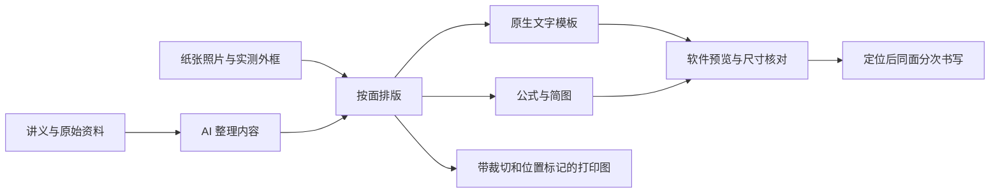

# LabPaper Plotter · 把时间还给大学生活

**AI 看资料、做排版，写字机动笔。我们已经把这条流程跑通了。**

水课已经占了时间，机械抄写就别再占一遍。

LabPaper Plotter 是一套让 AI 助手把资料变成实体纸面书写任务的开源流程：读材料、整理内容、按真实纸张排版，再通过写字机完成文字、公式和简图。**当前已在颂博士写字机／奎享雕刻上用于大物报告；大物是第一个落地场景。**

我们想把省下来的时间留给自己选的事：学一门喜欢的课，做个一直想做的项目，运动、见朋友，或者早点睡。大学生活里，应该有更多时间由自己安排。

仓库公开了 **可安装的 skill、实机字体与变形参数、毫米布局工具和原生模板示例**。从三线摆、扭摆报告到伏安特性预习，我们把反复调过的字号、定位、公式模式和翻面顺序记了下来，让下一次能接着用。

## 从资料到真笔落纸



你提供资料、实测数据和纸张，负责放纸、对笔尖及翻面；助手组织内容、安排各区位置、准备文件并操作软件。文字和公式共用这一面的原点，按阅读顺序完成后再翻纸。

当前仓库包含一个场景 skill：[`physics-lab-report`](skills/physics-lab-report/SKILL.md)。其他需要纸面书写的任务可以沿用这套思路，新增场景会在适配和试写后收录。

## 最值得拿走的几件事

- **一次定位，完成同一面。** 文字与公式共用外框左上角原点，本面写完再翻纸。在已验证正常回到起点的机器上，同面后续任务可沿用定位。
- **中文走原生字库，公式走图形。** 中文使用三套字库按 6∶4∶2 混合；分式、上下标和物理简图单独安排，避免把整页印刷文字拿去描边。
- **按毫米安排纸面。** 把纸张外框、栏目、图形和粘贴区统一成坐标，模板可复用，无需逐字拖位置。
- **下一次实验，沿用这套版面。** 保存各面的文字区域和底板位置，替换内容后更新预览，复用已经校准的纸张布局与字体参数。
- **机器写着，下一份先准备。** 本机已观察到运行期间切模式、载入下一份图稿成功；具体操作与验证范围见实机记录。
- **打印图也安排到最后一步。** 裁切线、实际尺寸、贴哪一面、距框角多远，直接写在打印载体上。

字体权重和变形设置见 [公开预设](presets/README.md)，实际验证范围见 [实机记录](docs/verified-workflow.md)。

## 为什么做这个

我们反对水课里的形式主义，也反对把重复抄写当成认真学习的证明。读懂原理、做实验、分析数据值得花时间；把已经整理好的内容再抄一遍，可以交给机器。

**解锁大学生活，先从拿回自己的时间开始。** 省下来的时间怎么用，由你决定。

这种想法有很多同路人。《上海交通大学生存手册》谈到对时间的自主安排，Paul Graham 写过亲自选择项目所带来的投入感，CS 自学指南展示了主动寻找好课程的路径。相关原文、同类项目与我们采用的观点见 [调研与灵感来源](docs/positioning-research.md)。

## 顺手跑通的校园自动化

除了纸面书写，我们还做过[学习通与知到的网课流程](docs/course-workflow.md)：复用已登录浏览器接续视频、记录章节进度，并结合手机投屏处理移动端任务。学习通两门课合计 77 节视频、77 份章测已在平台核验完成；知到已跑通视频接续和部分测验。

这部分作为实操小分享收在仓库里，讲清怎么衔接、遇到什么问题、最后核验到哪一步。它与写字机流程有同一个出发点：把反复点页面、盯进度的时间省下来。

## 从这里开始

需要支持本地 skill 的 AI 助手、自己的讲义和报告纸、合法取得的字库，以及奎享雕刻。仓库中的 Python 工具只需要 Python 3.10+，不需要第三方依赖。

1. 下载仓库，把 `skills/physics-lab-report` 文件夹放入助手的 skills 目录。Codex 常见位置为 `~/.codex/skills/`；已有同名 skill 时先比较并保留自己的本地设置。
2. 给助手讲义、报告纸照片/PDF、实测外框宽高；完成报告时再提供真实实验数据。说：

   > 用 physics-lab-report 整理这次物理实验报告。先看实际报告纸，统筹各面；按毫米安排文字、公式和粘贴区，生成各面独立模板，并检查软件预览。

3. 先用白纸核对字形、实际尺寸、原点和回到起点的行为，再写报告纸。正文、公式和完整预览的用途不同，见 [操作流程](skills/physics-lab-report/references/writing-machine.md)。

### 先生成一个匿名模板

```bash
python scripts/build_template.py examples/layout.json --output generated/demo.json
python -m unittest discover -s tests
```

在奎享表格模式中“模板 → 打开”生成的 JSON，再通过“文件 → 打开”自己的同面空白底板，核对尺寸并点“更新”。仓库附带的 [demo.json](examples/demo.json) 也是同一脚本生成的原生示例；它是匿名位置演示，未在报告纸上实写。`layout.json` 不是奎享原生文件。

本例外框为 149 × 207.5 mm。该数字来自本机案例，换纸要测自己的外框。脚本只生成文字模板；公式图稿、底板和剪贴 PDF 由 skill 根据本次实验另做。

## 仓库里有什么

| 文件 | 用途 |
|---|---|
| `skills/physics-lab-report/` | 可独立安装的报告 skill，含写字机流程与中文审稿规则 |
| `presets/` | 6∶4∶2 字库权重、真实保存的变形参数、文字尺寸预设 |
| `scripts/build_template.py` | 将毫米布局转为奎享原生 JSON，检查越界与区域重叠 |
| `examples/` | 匿名布局和可导入的原生模板 |
| `docs/verified-workflow.md` | 哪些已上机、哪些只是观察、哪些需要复测 |

## 字体、软件与适用范围

公开的是参数、模板结构和工作流程。仓库不包含 `.gfont`、Windows 字体、混合字体二进制、软件安装包、个人报告、学校原始模板或教师讲义。请在自己的环境里取得字库；参数文件不会安装字体。

这是社区流程，未与设备厂商建立官方关系。工具不会连接串口或自动启动机器；实机操作由助手通过用户授权的软件界面进行。对其他机型、软件版本和纸张，先验证毫米尺寸及原点。

报告中的测量数据、计算过程和结论需要真实可核对。使用方式须符合自己的课程要求。

## 许可与协作

本仓库原创代码、配置整理和文档以 [MIT](LICENSE) 发布。欢迎提交不同设备的实测记录：注明软件版本、纸张尺寸、模式、预览范围及观察结果。照片请先去除姓名、学号和其他个人信息。
